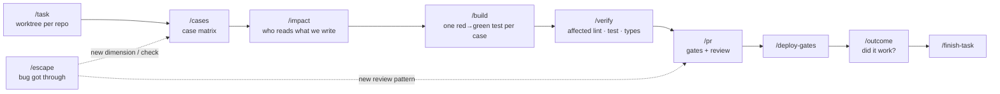

# agentic-dev-workflow

A delivery workflow for a coding agent ([Claude Code](https://docs.claude.com/en/docs/claude-code)) on a multi-repo
product: backend microservices, a frontend monorepo and a shared API-contract package.

It is the setup I use every day as a full-stack engineer. The goal is not "let the AI write code". It is to make an
agent **find the cases before coding, prove each one with a test, stay read-only on production data, and learn from
every bug that gets through**.

## The problem it solves

A coding agent is fast and confident. Left alone, it tends to:

- build what the brief says and miss the cases nobody wrote down (empty states, legacy rows, the second tenant);
- write a test that passes for the wrong reason, or mock the upstream that would have failed;
- edit the wrong checkout, push, or run a write against a shared database;
- make the same class of mistake again next week.

Each part of this repo closes one of those holes with a **gate the agent cannot talk its way past**, not a sentence in
a prompt.

## How a task flows



| Command | What it does |
|---|---|
| `/task` | Creates one git worktree per repo for the feature (`wt`), plus a notes file that every later step reads and updates. |
| `/cases` | Turns a brief into a case matrix (states × roles × data × time) using legacy code, real read-only data and a list of known product gaps. Open questions go to the PM, not into guesses. |
| `/impact` | Blast-radius sweep: from what the change *writes* (tables, values, index fields, events, emails), finds every reader across all repos. |
| `/build` | Implements case by case: a test named with the case id must fail for the right reason before any code is written. |
| `/verify` | Lint, test and type-check only what the worktree changed (Nx affected), behind a setup gate, with evidence in the notes. |
| `/pr` | Opens the PRs only when every agreed case has a test or a manual QA result; runs a review pass against learned patterns. |
| `/deploy-gates` | Post-merge checklist (migrations, config, deploy order) read from the notes; outputs commands for a human to run. |
| `/outcome` | ~7 days after deploy, reruns the task's success-signal query and records before → after. |
| `/triage` | Read-only investigation of a reported data/behaviour problem: evidence first, then code path, then a verdict and a reply. |
| `/debug-prod` | Read-only first look at a misbehaving service: logs, container state, last deploy, targets, alarms. |
| `/escape` | When a bug got past the process: find the task it came from, the stage it leaked at, and add **one concrete line** that closes the hole. |
| `/handoff`, `/sweep`, `/finish-task`, `/brag` | Session handoff, an overview of all open tasks, clean-up, and a private record of shipped work and its measured impact. |

Not included: `/qa` (browser and API QA against my product's test accounts) and `/run` (local service runner). They
are too product-specific to share; the commands that mention `/qa` treat it as an optional manual step.

## Guardrails (enforced by tools, not prompts)

- **Read-only data tools** — `tools/ro-sql.py` (Oracle), `tools/ro-pg.py` (Postgres) and `tools/ro-es` (Elasticsearch).
  Read-only is enforced by the database itself (`READ ONLY` transaction / `default_transaction_read_only`) plus a
  single-statement `SELECT` check; the Elasticsearch wrapper allows only query endpoints. Credentials come from env
  vars or a secret command, never from files.
- **Guard hook** — `hooks/guard.zsh` (a `PreToolUse` hook) asks before pushes, production profiles and edits in a main
  checkout, and refuses a PR when the case matrix is missing.
- **Worktrees per task** — `bin/wt` creates a feature worktree in every repo the task touches, and a release-branch
  twin with the feature commits cherry-picked, so main checkouts are never edited.
- **Throttled checks** — `bin/nice-run` and `bin/jest-fast` keep heavy test runs from freezing the laptop.

## It learns from its misses

Every bug found after the code was written — by a user, CI, a reviewer or QA — goes through `/escape`:

1. trace the faulty lines to the task that wrote them;
2. decide where it leaked: no case · wrong expectation · no test · test passed wrongly · review missed · deploy/config;
3. add one line where that stage will see it next time: a product-gap dimension (`knowledge/qa-product-gaps.md`),
   a QA check or review pattern (`knowledge/qa-checklist.md`), or a deploy gate.

`/cases` and `/pr` read those files on every run, so the same class of bug is caught earlier the next time.

## Evals: is the agent actually following the commands?

`evals/` measures compliance, not just output. It generates scenarios at three prompt strictness levels, runs the
agent in a sandbox where the data tools are stubs, classifies the tool-call sequence and reports which required steps
were skipped. A gold set for `/cases` checks whether the matrix finds cases that previously escaped. Fixtures here are
synthetic. See [`evals/README.md`](evals/README.md).

## Repository layout

```
commands/    slash commands (Markdown prompts with gates)
knowledge/   product-gap heuristics, QA/review checklist, escape-analysis procedure
hooks/       guard.zsh (PreToolUse), task-context.zsh
bin/ lib/    worktree tooling (wt, wt-ls, wt-state, wt-setup, wt-done, wt-open), nice-run, jest-fast
tools/       read-only database and search clients
evals/       compliance eval harness with synthetic fixtures
```

## Install

```bash
git clone <this repo> ~/agentic-dev-workflow && cd ~/agentic-dev-workflow
mkdir -p ~/.claude/commands ~/.claude/hooks ~/.local/bin ~/.config/agentic-dev
ln -s "$PWD"/commands/*.md ~/.claude/commands/
ln -s "$PWD"/knowledge/*.md ~/.claude/
ln -s "$PWD"/hooks/*.zsh ~/.claude/hooks/
ln -s "$PWD"/bin/* "$PWD"/tools/* ~/.local/bin/
cp lib/wt/workspace.conf.example ~/.config/agentic-dev/workspace.conf   # set WORKSPACE and REPOS
echo "source $PWD/lib/wt/functions.zsh" >> ~/.zshrc
```

Then register `~/.claude/hooks/guard.zsh` as a `PreToolUse` hook in `~/.claude/settings.json`.

The commands assume a workspace laid out as `~/code/<workspace>/{backend,frontend,api-contracts}` with task worktrees
under `~/code/<workspace>/tasks/<repo>/<task>`; adjust the paths in the commands if yours differ.

## Credits

The eval harness in `evals/` is adapted from an MIT-licensed skill-compliance tool; its licence is kept in
[`evals/LICENSE`](evals/LICENSE).
